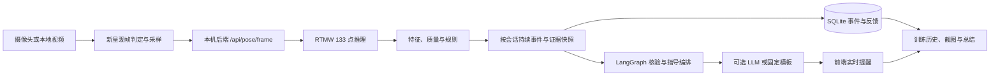

# YogaCoach-LLM

> 结合姿态证据与大语言模型的本地瑜伽辅助学习原型


## 项目介绍

居家练习瑜伽时，学习者通常一边观看示范、一边模仿动作，很难同时观察自己的身体位置，也不容易判断某个差异是否持续存在。练习结束后，零散的文字提醒又常常缺少对应画面，难以回顾问题出现的位置和当时收到的建议。

YogaCoach-LLM 尝试把**姿态观察、语言指导和练习回顾**连接起来：

- 浏览器从摄像头或本地视频获取画面，并发送到本机后端。
- 后端使用 RTMW 提取 COCO-WholeBody 133 个人体关键点，计算动作特征。
- 只有经过视角、动作阶段、图像质量和连续时间检查的持续偏差，才会成为可纠错事件。
- LLM 只读取筛选后的数值摘要与动作知识，生成简短、具体的建议；调用失败或输出不合规时回退到固定模板。
- 用户可以在练习时查看当前提醒和上一条建议，在练习后回看事件截图、对应建议与训练总结。

项目关注的问题是：**在姿态工具提供结构化证据的条件下，LLM 能否生成有依据、容易理解的指导，以及相关练习历史能否改善提醒的连续性与个性化。**

当前版本是一个可在本地运行、前后端已联调的原型，定位为**本机单人瑜伽辅助学习工具**。它只评价预先定义的可观察特征，不提供医疗诊断，也不把“模型检测通过”等同于动作标准或教学有效。

## 快速启动

### 环境要求

| 依赖 | 版本或说明 |
|---|---|
| Python | 3.12 |
| Node.js | 20+；CI 使用 Node.js 22 |
| Git LFS | 用于获取约 350 MB 的 RTMW 模型 |
| 浏览器 | 推荐最新版 Chrome 或 Edge；摄像头和语音能力依赖浏览器支持 |
| LLM API | 可选。OpenAI Chat Completions 兼容服务；未配置时使用本地模板 |

### Windows PowerShell

在仓库根目录依次执行：

```powershell
git clone https://github.com/Avocadohxx/YogaCoach-LLM.git
Set-Location YogaCoach-LLM

py -3.12 -m venv .venv
.\.venv\Scripts\Activate.ps1
python -m pip install -r requirements.txt

if (-not (Test-Path .env)) {
    Copy-Item .env.example .env
}

git lfs install
python -m scripts.download_pose_model

Set-Location frontend
npm ci
Set-Location ..
```

如果不希望使用当前 PowerShell 的激活脚本，也可以直接调用 `.venv\Scripts\python.exe`。已有 `.env` 时不要覆盖，尤其是其中配置了数据库路径或 API 密钥时。

启动后端（保持终端运行）：

```powershell
.\.venv\Scripts\python.exe -m uvicorn backend.main:app --host 127.0.0.1 --port 8000
```

另开一个终端启动前端：

```powershell
Set-Location frontend
npm run dev
```

浏览器访问 <http://127.0.0.1:5173>。前端开发服务器会把 `/api` 请求代理到本机 `8000` 端口。

### macOS / Linux

```bash
git clone https://github.com/Avocadohxx/YogaCoach-LLM.git
cd YogaCoach-LLM

python3.12 -m venv .venv
source .venv/bin/activate
python -m pip install -r requirements.txt

[ -f .env ] || cp .env.example .env
git lfs install
python -m scripts.download_pose_model

cd frontend
npm ci
cd ..
```

分别启动后端和前端：

```bash
python -m uvicorn backend.main:app --host 127.0.0.1 --port 8000
```

```bash
cd frontend
npm run dev
```

### 配置 LLM（可选）

编辑仓库根目录的 `.env`：

```dotenv
LLM_API_KEY=your_api_key
LLM_BASE_URL=https://api.deepseek.com
LLM_MODEL=deepseek-flash
```

保持 `LLM_API_KEY=replace_me` 或不配置相关变量时，系统仍可运行，并会使用审核过的固定提示。`.env` 已被 `.gitignore` 忽略，请勿提交真实密钥。

### 检查启动状态

```powershell
Invoke-RestMethod http://127.0.0.1:8000/api/health
Invoke-RestMethod http://127.0.0.1:8000/api/ready | ConvertTo-Json -Depth 5
```

`/api/health` 只表示后端进程存活。开始真实练习前，应确认 `/api/ready` 中：

- `model.available` 为 `true`；
- `database.connected` 为 `true`；
- 所需动作出现在 `rules` 中；
- `llm.configured` 为 `false` 时也能使用模板回退。

模型也可单独做一次加载冒烟检查：

```powershell
python -m scripts.check_model --image data/reference/tadasana_rtmw_original_correct_full/comparison_frame_2067ms.jpg
```

### 同源构建运行（可选）

前端构建完成后，后端会在下一次启动时托管 `frontend/dist`：

```powershell
Set-Location frontend
npm run build
Set-Location ..

.\.venv\Scripts\python.exe -m uvicorn backend.main:app --host 127.0.0.1 --port 8000
```

此时访问 <http://127.0.0.1:8000>。如果先启动后端、后执行构建，需要重启后端才能托管新的构建产物。

## 初步原型已实现的功能

当前原型已经形成从视频输入到练习回顾的完整本地链路，但仍处于课程项目验证阶段。

### 1. 摄像头与本地视频输入

- 支持摄像头和本地视频两种来源。
- 浏览器按新呈现帧采样，将 JPEG 画面发送到本机 `/api/pose/frame`。
- 暂停、跳转、缓冲、冻结、来源切换或动作阶段改变时，会撤回旧证据并重新建立连续事件。
- 摄像头按单调采集时间统计持续性，本地视频按媒体时间统计，避免暂停或跳转后的重复画面被当成持续动作。
- 推理设置并发上限；过期请求不会参与正式纠错。

### 2. RTMW 133 点姿态检测与特征计算

- 后端使用 `data/models/rtmw_x_384.onnx` 提取 COCO-WholeBody 133 点。
- 输入保留原始像素坐标与置信分数，不转换成 MediaPipe 33 点。
- 根据规则计算肘角、上臂对齐、肩高差、躯干倾角和踝距等特征。
- 质量检查依据当前规则实际依赖的关键点；例如脚踝未入镜不会阻断仍然可用的双肘测量。
- 当前使用单人全图 ROI，不支持多人检测或后台长视频任务。

### 3. 持续性姿态事件检测

当前在线规则入口为 [`knowledge/rules_manifest.json`](knowledge/rules_manifest.json)。

| 动作 | 当前纠错阶段 | 已接入的纠错能力 |
|---|---|---|
| 山式 | 举臂保持 | 对已审核配置中的持续肘部偏差进行确认、提醒和清除 |
| 站立侧弯式 | 举臂保持、侧弯保持 | 支持单臂/双臂持续肘部偏差、双臂上臂对齐，以及所选画面倾斜方向不符 |

补充说明：

- 站立侧弯式的纠错按用户请求作为**课程演示功能**启用，尚未完成专业教学审核与真实数据阈值验证。
- 肩高差、侧屈幅度、脚距等仍只用于测量和上下文，不单独触发纠错。
- 准备、过渡、未知变体、缺少举臂侧或画面方向、低质量测量均不会产生正式纠错。
- 偏差必须连续达到时间门限才会确认；回正也需持续一段时间才会清除。阈值是项目配置，不是通用人体标准。

### 4. 证据约束下的 LLM 指导

- 只有后端确认且仍然有效的持续偏差事件才能进入指导流程。
- Agent 使用 LangGraph 组织 `gate → tools → decide → compose → validate` 流程。
- LLM 读取当前动作、阶段、实测值、规则范围、持续时间和精选数值上下文。
- 后端检查反馈是否对应已确认事件和目标部位；模型不可用、超时或输出不合规时回退到固定安全话术。
- **摄像头图像、原始关键点、会话 ID 和任意历史原文不会发送给 LLM。**
- 同一事件不会重复提醒，纠错事件之间有冷却时间。

### 5. 实时练习页面

- 视频区域与提醒区域并排展示，便于把建议和当前画面放在一起理解。
- 分别显示“本次提醒”和“上一条建议”。
- 显示左右肘角、连接状态以及“正在确认”“取景不足”“阶段不匹配”等处理状态。
- 支持练习开始/结束、手动切换动作与阶段、动作变体、举起手臂和画面倾斜方向。
- 练习结束后显示服务器生成的本次总结，并可刷新查看已保存记录。

### 6. 语音交互（代码已接入，设备表现待验收）

- 支持中文语音口令：准备、开始举臂保持、双臂放下保持、切换动作、开始侧弯保持、结束练习。
- 有效建议可通过浏览器语音合成播报；播报期间暂停识别，旧阶段或旧证据会取消播报。
- 语音识别不可用、权限被拒绝或浏览器不支持时，仍可继续手动操作。
- 系统不主动保存录音，但浏览器语音识别服务可能把音频发送到外部服务，因此不能承诺完全离线。
- 自动测试使用模拟语音引擎；真实麦克风、中文识别准确率和播放时机仍需在目标设备上人工验收。

### 7. 练习记录、截图与历史详情

- 使用 SQLite 保存会话、确认事件、反馈、用户偏好和事件截图元数据。
- 可信偏差出现时，从当前画面和 133 点骨架覆盖层截取 JPEG，同一事件不会逐帧重复截图。
- 截图默认保存在 `data/evidence/<session-hash>/`；图片保存在本机磁盘，不写入浏览器 `localStorage`。
- `#/history` 汇总已保存的练习，`#/history/<session_id>` 显示训练摘要、事件相对时间、截图、对应建议和建议时间线。
- 删除单次会话或用户全部数据时，会同时删除对应数据库记录和截图。
- 异常离开通过心跳超时标记为中断，不虚构正常结束或动作改善。

### 8. 练习总结与历史上下文

- 结束练习时，总结只基于已入库的可信偏差和本次实际显示的反馈。
- 总结区分姿态纠错、镜头/观察提示和其他练习提示，并统计出现次数。
- 可读取同一用户、同一动作的历史规则事件，用于调整后续提醒的关注重点；手写摘要不会被当作新的测量事实。
- 跨次训练总结按训练记录缓存，打开历史详情不会自动重复调用 LLM。

### 9. 自动化检查与评测工具

- 后端测试覆盖 133 点特征、规则判定、事件持续性、证据失效、Agent 输入/回退、记忆和历史媒体。
- 前端使用 Vitest 与 Testing Library 检查采集、会话、语音、历史页和主要页面状态。
- `experiments/` 中包含规则审计、回放脚本、合成案例、延迟基准和记忆层检查工具。
- 24 个合成场景用于流程与边界检查，不能作为真实视频准确率；目前不声明尚未测得的准确率或教学改善比例。

## 使用流程

1. 启动后端和前端，打开 <http://127.0.0.1:5173>。
2. 选择“山式”或“站立侧弯式”，选择摄像头或本地视频。
3. 点击“开始练习”，先在“准备中”阶段调整全身入镜并摆正摄像头。
4. 动作稳定后切换到“双臂举起并保持”或适用的“侧弯保持”。
5. 使用侧弯动作时，先选择单臂/双臂、举起侧和计划倾斜方向；其中方向指**画面左右**，不直接等同于人体解剖左右。
6. 持续偏差经过确认后，页面显示建议并保存事件；LLM 未配置时使用模板。
7. 点击“结束并查看记录”，在“训练历史”中回看总结、截图和当时建议。

如果只有角度而没有纠错，先检查页面状态和 `/api/pose/frame` 返回中的 `reason_codes`、`rule_evaluation`、`pending_count` 与 `feedback_allowed`。单帧测量不会绕过持续性和质量门限直接触发提醒。

## 系统架构



技术栈：

- **前端**：React 19、TypeScript、Vite、Vitest
- **后端**：FastAPI、Pydantic、NumPy、OpenCV
- **姿态模型**：RTMW、COCO-WholeBody 133 点、ONNX Runtime
- **指导流程**：LangGraph、OpenAI Chat Completions 兼容 API
- **本地存储**：SQLite、本地 JPEG 截图

## 目录结构

```text
YogaCoach-LLM/
├── backend/        FastAPI 路由、姿态分析、规则、Agent 与 SQLite
├── frontend/       React 练习页、历史页、采集与语音服务
├── knowledge/      动作知识、在线规则与安全回退模板
├── data/           RTMW 模型、参考帧与本地截图目录
├── tests/          后端规则、Agent、API、记忆与媒体测试
├── experiments/    规则回放、合成案例、延迟与记忆评测
├── contracts/      前后端数据契约和模拟响应
└── docs/           架构、特征、历史截图与验收说明
```

## 数据库与配置

数据库路径按以下优先级解析：

1. `YOGACOACH_DB_PATH`
2. `DATABASE_PATH`
3. 默认 `data/yogacoach.db`

相对路径以仓库根目录为基准。`.env.example` 当前示例使用 `DATABASE_PATH=./data/yoga.db`；如果直接复制模板，实际数据库为 `data/yoga.db`。已有数据库不会在启动时自动迁移或搬移。

主要配置：

| 变量 | 用途 | 是否必需 |
|---|---|---|
| `POSE133_MODEL_PATH` | RTMW ONNX 模型路径 | 默认可省略 |
| `DATABASE_PATH` | SQLite 文件路径 | 否 |
| `LLM_API_KEY` | LLM 服务密钥 | 否 |
| `LLM_BASE_URL` | Chat Completions 兼容服务地址 | 使用 LLM 时必需 |
| `LLM_MODEL` | 模型名称 | 使用 LLM 时必需 |
| `YOGACOACH_MEDIA_DIR` | 事件截图目录 | 否 |

## 测试与验证

后端测试：

```powershell
python -m pytest -q
python -m scripts.check_sources
```

前端测试与构建：

```powershell
Set-Location frontend
npm test
npm run build
Set-Location ..
```

模型吞吐基准（准备阶段的重复图像测量，不代表浏览器真实帧率）：

```powershell
python -m scripts.benchmark_pipeline --image data/reference/tadasana_rtmw_original_correct_full/comparison_frame_2067ms.jpg --frames 20
```

真实效果评估还需要经过授权的视频、人工偏差标注、模型版本记录和独立测试片段。当前自动化测试与规则审计只能证明流程和已定义规则按预期执行，不能证明动作教学效果。

## 当前限制

- 仅面向 `127.0.0.1`、单人、正面拍摄和单 worker 的本地演示，没有账号鉴权，不应直接暴露到公网。
- AI 训练视频与内置示范视频尚未接入；页面中的示范内容仍需补充授权素材。
- 正式纠错范围较窄，当前规则阈值不是通用人体标准；站立侧弯式仍是课程演示能力。
- 真实摄像头、不同设备、不同身形、取景距离、语音识别和截图时间对应仍需人工验收。
- LLM 的生成质量、历史上下文带来的改善以及检测准确率尚未形成最终实验结论。
- RTMW 分数不是概率或 MediaPipe visibility，不能直接解释为医疗或教学置信度。
- 不提供医疗诊断；练习中出现疼痛、眩晕或其他不适时应立即停止并寻求专业帮助。

## 相关文档

- [系统架构](docs/architecture.md)
- [133 点视频与摄像头链路](docs/133点视频与摄像头链路.md)
- [特征与检测规则](docs/detection_rules_133.md)
- [正式纠错实现与验收](docs/正式纠错实现与验收.md)
- [训练历史截图与详情](docs/training_history.md)
- [记忆设计](docs/memory_design.md)
- [实时纠错与 LLM 联调说明](README-C.md)

## 团队

课程项目成员：Liu Tianyue, Tang Zichun, Huang Xinxuan, Ma Jia, Lu Jiayi。

项目参考：[DeepTutor](https://github.com/HKUDS/DeepTutor)、[nanobot](https://github.com/HKUDS/nanobot)。
