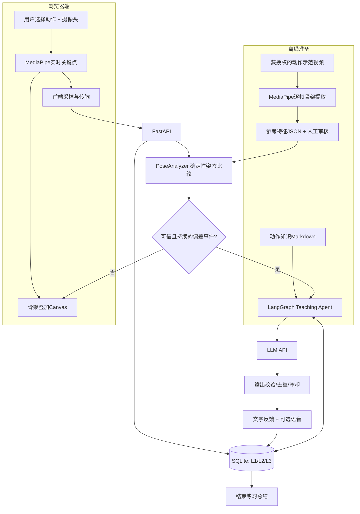
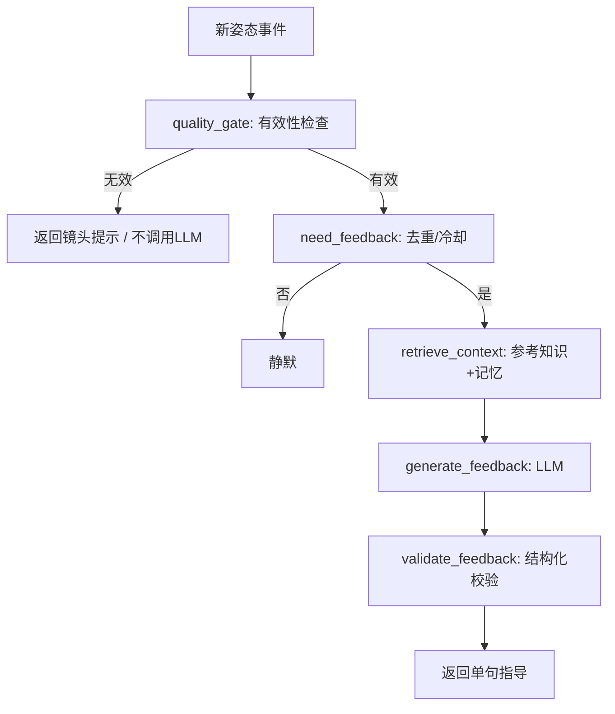

# YogaCoach Agent V1.3：两周可交付的最小完整实现方案

> **项目定位**：以 LLM / Agent 为核心的瑜伽动作辅助学习系统（课程项目）  
> **开发周期**：14 天（Mini MVP）  
> **项目原则**：**借鉴** DeepTutor 的教学闭环、nanobot 的分层记忆思想，**不依赖或复现**这两个项目的源码或运行框架。  
> **核心架构**：React + MediaPipe Pose Landmarker + FastAPI + LangGraph + LLM API + SQLite  
> **首版动作**：山式（Tadasana）、战士二式（Warrior II），由用户主动选择  
> **训练要求**：V1.3 **不训练 TCN / LLM / VLM**；使用预训练的人体姿态估计模型、可解释的几何分析和现成 LLM API。

---

## 0. 一页摘要

本项目提供标准瑜伽动作视频和实时摄像头骨架可视化。用户主动选择一种动作后，系统用 MediaPipe 提取人体关键点，利用 Python 的确定性姿态分析工具与对应参考动作特征进行对比。检测到**可信、持续**的可观察偏差时，LangGraph Agent 结合动作知识和练习记忆，决定是否提供一句简短指导，并通过网页文字和可选语音输出。练习结束后生成总结，下次练习可引用经过筛选的历史摘要。

**要回答的研究问题**：在结构化姿态工具已提供检测结果的前提下，工具增强与轻量跨会话记忆，是否能提高 LLM 反馈的事实依据性、减少重复提醒，并改善上下文一致性？

**最小闭环**：

```text
选择动作 → 参考视频 → 开启摄像头 → 33点骨架 → 姿态偏差事件
      → Agent工具/记忆 → 决策 → 一句反馈 → 训练结束总结 → 下次读取
```

**MVP 成功标准**：两种动作、两个可解释偏差检测项、一个 Agent、三个工具、三层轻量记忆、三组最小实验，稳定演示完整闭环。

---

## 1. 需求与范围控制

### 1.1 V1.3 必须有（Must Have）

| 模块 | MVP 功能 | 验收方式 |
|---|---|---|
| 标准学习 | 支持选山式/战士二式，播放获得使用许可的示范视频 | 两动作可切换 |
| 实时感知 | 摄像头 33 个关键点、骨架连线 | 骨架随画面更新 |
| 标准对照 | 每个动作一个正面视角参考特征 JSON | 可返回参考值与有效性信息 |
| 姿态分析 | 至少两个独立的轻微、可观察偏差检测项 | 有对应测试样例 |
| Agent | LangGraph 事件触发、调用工具、生成一句话建议 | 不在每一帧调用 LLM |
| 反馈控制 | 低置信度拒绝、持续性校验、去重、冷却时间 | 可重现测试 |
| 记忆 | L1 事件、L2 会话总结、L3 经用户确认的偏好 | 跨会话读取与删除 |
| 可交互演示 | React 视频/骨架/参考视频/文字反馈 | 本地浏览器运行 |
| 实验 | 姿态检测 + 反馈对照 + 记忆验证 | 有脚本、结果表 |

### 1.2 V1.3 暂不做（Won't Have）

- 不训练或微调动作分类模型、TCN、ST-GCN、LLM、VLM。
- 不自动识别大量瑜伽动作：**用户自己选动作**。
- 不开发多 Agent 系统、MCP Server、复杂 Skills Registry。
- 不开发 GraphRAG、向量库、长期自动 Dream 任务、GitStore 记忆版本系统。
- 不进行云端实时视频上传、不做多用户登录、多人姿态检测。
- 不做临床评估、康复诊断、精确三维关节生物力学分析。
- 不保证所有视角可用；首版限定**正面拍摄且全身可见**。

### 1.3 时间紧张时的保留顺序

1. MediaPipe 骨架、姿态分析的准确性和异常拒绝。
2. React + FastAPI 的端到端闭环。
3. Agent 工具调用与反馈冷却。
4. SQLite 会话记忆与复用。
5. 语音、UI 美化、细节图表（可最后做）。

---

## 2. 从 DeepTutor 与 nanobot 借鉴哪些思想

**不是以 DeepTutor/nanobot 为底座**；只把它们的适用功能设计成 YogaCoach 自有模块。

| 来源 | 借鉴思想 | YogaCoach 简化实现 | 不做什么 |
|---|---|---|---|
| DeepTutor | Guided Learning / 分步指导 | `LEARN → PRACTICE → FEEDBACK → REVIEW` 四阶段 | 不复现课程管理平台 |
| DeepTutor | Grounded Feedback / 有依据的反馈 | LLM 只能依据工具输出和审核知识生成指导 | 不做 GraphRAG |
| DeepTutor | 学习日志/复习总结 | 训练记录 + 练习结束总结 | 不做复杂学习路径规划 |
| DeepTutor | 可检查的学习记忆 | 可查看会话总结及偏好来源 | 不做知识图谱 |
| nanobot | 会话短期记忆 | 会话状态 + 最近几条反馈 | 不引入 nanobot SDK |
| nanobot | 上下文压缩 | 练习结束生成一次摘要 | 不运行定时 Consolidator |
| nanobot | 长期信息提炼 | 抽取候选偏好，用户确认后写入 | 不自动永久记住所有观察 |
| nanobot | 工具/技能模块化 | 三个普通 Python Tool | 不引入独立插件基础设施 |

**边界**：参考架构思路，而非复制两个项目的完整内部组件或声称兼容其 API。具体实现和测试由本项目独立完成。

---

## 3. 总体系统架构



### 3.1 分工原则

- **MediaPipe**：只负责把图像转换成有置信度的骨架关键点。
- **PoseAnalyzer**：负责角度、相对位置、参考区间、遮挡判断和偏差事件，不调用 LLM。
- **Agent**：负责调用工具、查询记忆、选择反馈时机与指导内容，不自行捏造关节测量值。
- **LLM**：负责组织简短、具体、温和的自然语言，不替代姿态测量。
- **SQLite**：存事件、总结、偏好与来源，不存每一帧的巨大骨架数组。
- **React**：负责互动、实时骨架、练习状态与可选 TTS。

### 3.2 为什么不需要训练动作识别模型

V1.3 中用户**先选动作**，因此 `pose_id` 是确定的。系统只对当前动作的参考模板做有限评估，不需要独立预测属于哪一种动作。这让开发量显著下降，同时仍保留了可被验证的 AI Agent 研究问题。

---

## 4. 最小数据集与参考动作构建

### 4.1 先做 2 个动作，优先正面视角

| ID | 动作 | V1.3 仅分析 | 不评判 |
|---|---|---|---|
| `mountain` | 山式 Tadasana | 双肩相对高度、躯干侧倾 | 身体“完美度”、所有关节是否标准 |
| `warrior2` | 战士二式 Warrior II | 双臂相对高度、躯干侧倾 | 膝盖承重安全、身体旋转深度、三维受力 |

正面机位、全身在画面内；对不匹配的拍摄视角直接提示调整。只给出温和的视觉对齐提醒，**不强制追求某个固定幅度或角度**。

### 4.2 参考数据最小规模

- 每个动作最少 1 段**授权且经检查的标准示范**，优先 3–5 段不同人的示范，提取稳定片段。
- 每段 5–15 秒，MediaPipe 目标采样 10–15 FPS。
- 参考值从有效片段的特征分布计算（如中位数、合理的分位范围），再人工复核。
- 首版不足以建立“所有人统一标准”；参考区间仅用于**检测相对示范的视觉差异**。
- 数据应记录 `source_video`、参与者授权信息、拍摄视角、审核人员及审核日期。

### 4.3 关键点格式

MediaPipe Pose Landmarker 通常提供 33 个身体关键点及其二维归一化坐标、相对深度和置信度信息（可用字段依模型和平台而定）。

```json
{
  "frame_timestamp_ms": 12000,
  "landmarks": [
    {"x": 0.50, "y": 0.13, "z": -0.12, "visibility": 0.98}
  ],
  "num_landmarks_expected": 33,
  "camera_view": "front"
}
```

> 上面仅展示一个关键点的示意结构。在线真实请求需包含 33 个关键点；不得把一个点误当作完整姿态。

### 4.4 核心几何特征

需要有左右肩（11/12）、左右髋（23/24）、左右肘（13/14）、左右腕（15/16），必要时参考左右膝（25/26）、脚踝（27/28）。关节点编号按照 MediaPipe Pose Landmarker 官方拓扑。

**躯干中心**：

\[
H=(p_{23}+p_{24})/2,\qquad S=(p_{11}+p_{12})/2
\]

**尺度**：

\[
s=\max(\|S-H\|,\epsilon)
\]

**双肩相对高度差（正面）**：

\[
d_{shoulder}=|y_{11}-y_{12}|/s
\]

**躯干侧倾（正面）**：

\[
\theta_{torso}=\operatorname{atan2}(|S_x-H_x|,|S_y-H_y|)\cdot 180/\pi
\]

**双臂相对高度差（战士二式示范检测）**：可用双腕相对肩部中心的归一化高度差，并检查左右肩、肘、腕可见性；具体方向阈值依示范视角而定。

**检测规则**：超过参考区间不等于“危险”或“错误”，只能标注为“与参考姿态存在可观察差异”；敏感/不确定的判断应拒绝输出。

### 4.5 参考模板示例

```json
{
  "pose_id": "mountain",
  "name_zh": "山式",
  "supported_camera_views": ["front"],
  "features": {
    "shoulder_height_diff": {"reference_low": 0.00, "reference_high": 0.10},
    "torso_tilt_deg": {"reference_low": 0.0, "reference_high": 7.0}
  },
  "requirements": {
    "min_visibility": 0.75,
    "required_landmark_ids": [11, 12, 23, 24],
    "min_valid_duration_ms": 1500
  },
  "metadata": {
    "version": "demo-v1",
    "status": "UNVALIDATED_DEMO_VALUES",
    "view": "front"
  }
}
```

**重要**：JSON 中的 `0.10`、`7.0` 和可见度 `0.75` 均是**接口演示值**，不是安全或医学阈值，更不能直接认为适用于全部用户。真实项目应从示范数据计算区间并经人工评估与测试校准。

---

## 5. 姿态感知与偏差事件

### 5.1 推荐工作流程

```text
打开摄像头 → MediaPipe 检测 → 骨架绘制 → 关键点质量检查
 → 计算特征 → 与选定动作参考模板比较
 → 连续 1–2s 检测到同一可信差异 → 产生事件
 → 冷却/去重 → 发送 Agent
```

### 5.2 质量门禁

以下情形**不允许**生成具体的动作纠正：

1. 未检测到单个完整的人体。
2. 相关关节点可见性不足、连续丢失或被遮挡。
3. 用户身体未完整入镜，或视角不是当前模板支持的正面视角。
4. 处于姿势变化过渡期，尚未稳定。
5. 摄像头帧率过低、网络延迟影响结果时。

可返回：`请调整摄像头，确保全身进入画面后再继续。`

### 5.3 持续性与节流参数（待测试调整）

| 参数 | 初始值 | 说明 |
|---|---:|---|
| 浏览器采集 | 24–30 FPS | 取决于设备 |
| MediaPipe 处理 | 10–15 FPS | 优先流畅和稳定 |
| 上传后端分析 | 5 Hz | 非每帧调用 Agent |
| 偏差持续时间 | 1.5 秒 | 过滤偶发抖动 |
| 一次语音冷却 | 10 秒 | 防止打断练习 |
| 同类反馈去重 | 同一会话内优先不重复 | 变化后可重新评估 |
| LLM 调用 | 有新事件才调用 | 限制成本与延迟 |

### 5.4 结构化事件协议

```json
{
  "session_id": "s001",
  "pose_id": "mountain",
  "timestamp_ms": 1731500000000,
  "tracking": {"valid": true, "camera_view": "front"},
  "event": {
    "type": "shoulder_height_difference",
    "feature_name": "shoulder_height_diff",
    "observed_value": 0.16,
    "reference_range": [0.0, 0.10],
    "confidence": 0.87,
    "duration_ms": 1800,
    "level": "mild",
    "evidence": "双肩归一化高度差高于示范参考上界"
  }
}
```

LLM 只读取这样的事件和知识，而非全部实时视频；原始视频默认不上传。

---

## 6. 一个 Agent + 三个工具

### 6.1 工具定义

| 工具 | 输入 | 输出 | 具体职责 |
|---|---|---|---|
| `get_reference_pose` | `pose_id` | 参考特征、动作说明、视角要求 | 取本地 JSON/Markdown |
| `analyze_pose` | `pose_id`, 当前骨架/已有特征 | 测量值、有效性、偏差事件 | 纯 Python 几何算法 |
| `get_training_memory` | `pose_id`, `session_id` | 当前会话反馈与历史摘要、偏好 | 从 SQLite 检索 |

**工具调用原则**：Agent 可以选择查询相关工具，但不会有权限随意修改长时记忆；保存事件和总结由后端服务完成。为了减小实时开销，后端可先确定性执行 `analyze_pose`，然后将有效事件交给 Agent；Agent 只在必要时查询参考知识与记忆。

### 6.2 LangGraph 最简节点



**不要过度工程化**：初期四个节点加一个条件分支足够，没必要把每个 Tool 拆成独立 Agent。

### 6.3 Agent State

```python
from typing import TypedDict, Optional

class CoachState(TypedDict):
    session_id: str
    pose_id: str
    tracking_valid: bool
    event: Optional[dict]
    reference: dict
    recent_feedback: list[str]
    long_term_preferences: dict
    should_feedback: bool
    feedback: Optional[dict]
```

### 6.4 Prompt（最小可用版本）

```text
你是 YogaCoach 的辅助动作指导 Agent。
仅依据本次姿态分析工具返回的可信事件、当前参考动作知识、
以及用户明确保存的偏好输出建议。

要求：
1. 不要自行推断没有被检测到的姿态问题。
2. 检测状态不可靠时只提示调整摄像头，不纠正身体动作。
3. 每次最多反馈一个具体观察点，尽量不超过 60 个汉字。
4. 不要求用户用力追求特定角度或伸展极限。
5. 避免与刚才的提醒重复。
6. 不提供医疗诊断、治疗或康复判断。
7. 用户报告疼痛或不适时建议暂停练习。
8. 严格输出约定 JSON，不附加其他说明。
```

### 6.5 LLM 输出 Schema

```json
{
  "should_speak": true,
  "feedback_type": "pose_observation",
  "target": "shoulders",
  "text": "检测到双肩高度有些差异，可以在舒适范围内放松肩部，观察两侧位置。",
  "grounded_event_type": "shoulder_height_difference"
}
```

校验层检查 `grounded_event_type` 确实存在、目标部位匹配事件、文本长度合规、没有冒进的指导。校验不通过时使用**审核过的固定模板**或静默，不能将不合格的 LLM 文本直接朗读。

---

## 7. 轻量分层记忆：借鉴思想，独立实现

### 7.1 三层记忆

**L1：事件记忆**：本次练习的 `pose_id`、有效偏差事件、反馈文本、时间戳。用途是即时上下文、去重和冷却。

**L2：会话记忆**：每次结束时生成 100–200 字的练习摘要，包含测量事件统计、提供过的建议和未评估情况。摘要必须能追溯到本次事件日志。

**L3：长期偏好记忆**：只存用户明确确认的偏好，如“希望反馈更简短”“更喜欢文字而不是语音”。不把短期偏差、健康判断或视频观察自动固化为永久个人事实。

### 7.2 记忆读取流程

```text
开始 Session 2
  ↓
用户选中 mountain
  ↓
查询最近 1–3 次 mountain 会话摘要
  ↓
查询用户已确认的反馈偏好
  ↓
只给 Agent 少量相关上下文
  ↓
Agent 结合当前新事件决定是否反馈
```

### 7.3 SQLite 最小表结构

```sql
CREATE TABLE IF NOT EXISTS sessions (
  id TEXT PRIMARY KEY,
  pose_id TEXT NOT NULL,
  started_at TEXT NOT NULL,
  ended_at TEXT,
  summary TEXT
);

CREATE TABLE IF NOT EXISTS feedback_events (
  id INTEGER PRIMARY KEY AUTOINCREMENT,
  session_id TEXT NOT NULL,
  timestamp_ms INTEGER NOT NULL,
  event_type TEXT NOT NULL,
  feature_name TEXT,
  observed_value REAL,
  confidence REAL,
  feedback_text TEXT,
  FOREIGN KEY(session_id) REFERENCES sessions(id)
);

CREATE TABLE IF NOT EXISTS preferences (
  key TEXT PRIMARY KEY,
  value TEXT NOT NULL,
  user_confirmed INTEGER NOT NULL DEFAULT 0,
  updated_at TEXT NOT NULL
);
```

建议增加最基本的 API 支持用户查看/清除会话与偏好；不存可识别的人脸视频。不把数据库文件上传到公开仓库。

### 7.4 Session Summary

练习结束时汇总确定性统计：总练习时长、有效检测时长、各偏差事件次数与时长、Agent 发言条数。之后才调用 LLM 改写为清晰摘要，**严禁 LLM 伪造次数、趋势或改善结果**。若当前只有一次练习，则不能声称长期改善。

### 7.5 简化版“记忆提炼”

- 不跑定时自动 Dream。
- 每次结束给出**候选记忆**，例如“你希望下次提醒更简洁吗？”
- 只有用户明确确认才写入 L3。
- 界面提供“查看/修改/清除偏好”。
- L2 可以自动保存客观会话总结，但可供用户删除。

---

## 8. DeepTutor 风格教学闭环

四个阶段足够，不需要课程平台：

```text
LEARN 观看标准视频与关键观察点
  ↓
PRACTICE 摄像头实时检测与骨架叠加
  ↓
FEEDBACK 可信事件触发 Agent 一句指导
  ↓
REVIEW 结束总结与下次练习提示
```

页面设计：

1. **Learn 区**：两个动作卡片、视频、文字讲解、支持视角。
2. **Practice 区**：左侧实时摄像头 + 骨架，右侧参考视频；下方检测状态与文字反馈。
3. **Review 区**：练习时长、有效检测时长、实际观察到的偏差事件、历史总结。
4. **Preferences 小弹窗**：语音开关、反馈长度、查看和清除保存的长期偏好。

前端优先一个页面通过状态切换展示，不需要路由、设计系统或多页框架。

---

## 9. API 协议与接口

推荐使用 HTTP REST，第一版先不要 WebSocket。

| 方法 | 路径 | 说明 |
|---|---|---|
| GET | `/api/health` | 服务健康检查 |
| GET | `/api/poses` | 两种动作及参考视频路径 |
| POST | `/api/sessions` | 创建练习会话 |
| POST | `/api/pose/analyze` | 一批关键点 → 可信测量和事件 |
| POST | `/api/agent/feedback` | 可信事件 → Agent 一句指导 |
| POST | `/api/sessions/{id}/finish` | 结束练习并生成摘要 |
| GET | `/api/sessions/{id}` | 查询单次练习总结 |
| GET | `/api/memory` | 查询相关历史摘要与偏好 |
| PUT | `/api/preferences` | 用户确认或修改偏好 |
| DELETE | `/api/preferences/{key}` | 清除某条偏好 |

### 9.1 `/api/pose/analyze` 请求

```json
{
  "session_id": "s001",
  "pose_id": "mountain",
  "camera_view": "front",
  "timestamp_ms": 12500,
  "landmarks": [
    {"x": 0.50, "y": 0.10, "visibility": 0.98}
  ]
}
```

> `landmarks` 上面只写一个元素作为说明，真实接口强制要求 33 个元素，并校验所有必要关节点。用于判断“持续偏差”的时间状态由后端同一 Session 跟踪；不能由前端传一个 `duration_ms` 就认定可信。

### 9.2 `/api/pose/analyze` 返回

```json
{
  "tracking_valid": true,
  "pose_id": "mountain",
  "observations": [
    {"name": "shoulder_height_diff", "value": 0.16, "unit": "torso_scale"}
  ],
  "events": [
    {"type": "shoulder_height_difference", "confidence": 0.87, "persisted_ms": 1800}
  ],
  "agent_eligible": true
}
```

`agent_eligible` 应由后端质量控制、持续时间及冷却判断确定，而不是让 LLM 来决定测量是否有效。

### 9.3 `/api/agent/feedback` 返回

```json
{
  "should_speak": true,
  "text": "检测到双肩高度有些差异，可以在舒适范围内调整并观察。",
  "target": "shoulders",
  "source_event": "shoulder_height_difference"
}
```

---

## 10. 两周目录结构（保持极简）

```text
YogaCoach/
├── README.md
├── requirements.txt
├── .env.example
├── .gitignore
├── frontend/
│   ├── package.json
│   └── src/
│       ├── App.tsx          # Learn/Practice/Review 一个界面
│       ├── Camera.tsx       # 摄像头 + MediaPipe
│       ├── Skeleton.tsx     # Canvas 骨架叠加
│       └── api.ts           # 后端调用
├── backend/
│   ├── main.py              # FastAPI 路由
│   ├── pose_analyzer.py     # 角度/视角/置信度/差异事件
│   ├── agent.py             # LangGraph 主流程
│   ├── tools.py             # 三个工具
│   ├── memory.py            # L1/L2/L3 查询与管理
│   └── database.py          # SQLite 表与连接
├── data/
│   ├── mountain.json
│   ├── warrior2.json
│   ├── yoga.db               # 不提交版本控制
│   └── videos/               # 获得授权的示范视频
├── scripts/
│   └── extract_reference.py # 离线参考骨架提取
├── experiments/
│   ├── cases.json           # 标注的小规模案例
│   ├── replay.py            # A/B/C 离线回放
│   └── results.csv
└── tests/
    ├── test_pose.py
    ├── test_memory.py
    └── test_agent.py
```

### 10.1 环境准备

参考环境：Python 3.11、Node.js LTS，具体版本与依赖以安装时兼容性测试为准。

```bash
python -m venv .venv
source .venv/bin/activate
pip install fastapi uvicorn mediapipe opencv-python numpy pydantic langgraph langchain-openai python-dotenv

cd frontend
npm create vite@latest . -- --template react-ts
npm install
npm install @mediapipe/tasks-vision
```

注意：实际开发时应固定验证过的依赖版本，保留 `requirements.lock` 或 `pip freeze`；`langchain-openai` 可连接兼容 OpenAI API 的模型服务，但必须根据提供方文档设置基础地址、模型名称及鉴权，不应假设任意模型 API 都完全兼容。

`.env.example`：

```env
LLM_API_KEY=replace_me
LLM_BASE_URL=https://example.com/v1
LLM_MODEL=replace_me
DATABASE_PATH=./data/yoga.db
```

**不要提交真实 API 密钥**。摄像头权限通常要求 localhost 或 HTTPS 安全上下文。

### 10.2 启动方式（完成代码后）

```bash
# Terminal A：启动后端
source .venv/bin/activate
uvicorn backend.main:app --reload --port 8000

# Terminal B：启动前端
cd frontend
npm run dev
```

上述是**目标启动命令**，不是已经生成并验证运行的完整仓库；各模块实现完成后才能执行端到端验证。

---

## 11. 14 天任务拆解（最小交付优先）

| Day | 开发任务 | 可见成果 | 完成判定 |
|---|---|---|---|
| 1 | 建仓库、配置前后端、摄像头授权 | React 摄像头页面 | 能稳定显示画面 |
| 2 | MediaPipe 33点提取、Canvas 骨架 | 实时火柴人 | 关节点与画面同步 |
| 3 | 收集授权示范片段、离线导出参考特征 | 两个 JSON | 每份含动作/视角/参考特征 |
| 4 | 实现几何特征与质量门禁 | PoseAnalyzer | 无效关键点不强行纠错 |
| 5 | 持续偏差事件、去重和冷却 | 有效事件流 | 抖动不产生海量事件 |
| 6 | FastAPI 端点 + React 联调 | 本地完整视觉链路 | 页面能显示偏差信息 |
| 7 | LangGraph 单 Agent + 3 Tools | 结构化 AI 反馈 | 能基于事件生成一句话 |
| 8 | Prompt、安全校验、静默/模板回退 | 稳定指导 | LLM 异常不崩溃 |
| 9 | SQLite L1 + L2、结束总结 | 会话日志/总结 | 本次结果能重新打开 |
| 10 | L3 偏好、跨次读取、可选语音 | 个性化闭环 | 第二次练习能引用确认偏好 |
| 11 | 样例标注、几何检测实验 | 实验 1 | 有可核对的指标 |
| 12 | A/B/C 反馈回放 | 实验 2、3 | 有结果 CSV 和人工评价 |
| 13 | 异常场景、边界与延迟测试 | 测试报告 | 遮挡/低置信度正确处理 |
| 14 | README、部署演示、PPT、录屏 | 提交成品 | 可稳定连续演示 |

**里程碑**：

- **Day 2**：能看到骨架。
- **Day 6**：不依赖 LLM，也能完成姿态差异检测。
- **Day 8**：Agent 能输出可信的反馈。
- **Day 10**：会话与长期偏好可跨次使用。
- **Day 14**：有运行视频、实验结果、README。

---

## 12. 最小实验设计

### 实验 1：姿态检测可靠性

**问题**：几何姿态工具能否正确发现所定义的“可观察差异”，并在证据不足时拒绝评价？

**材料**：至少 20 个经授权的短片段，覆盖两个动作、正常示范、轻微自然偏差、遮挡和拍摄视角不合适等情况。每个片段用人工审核标注“有偏差/无偏差/不可评估”和偏差类型。

**指标**：按事件类型统计 Precision、Recall、F1；额外报告误报个数、不可评估正确拒绝率。

**注意**：样本很少，只能做技术可行性验证，不声称具备人群泛化能力。

### 实验 2：Agent 工具增强与记忆消融

对同一批事件离线重放，比较三组：

| 组别 | 输入与输出 | 目的 |
|---|---|---|
| A：Template | 同一检测事件 → 固定模板 | 非 LLM 基线 |
| B：Agent | 同一检测事件 + 动作知识 → LLM | 评估 LLM 带来的变化 |
| C：Agent+Memory | B + 相应历史摘要/偏好 → LLM | 评估跨会话上下文价值 |

**建议 20–30 个案例**（包含连续多轮事件、重复偏差和跨会话场景），使用相同检测事件、相同模型版本和评估标准。

**评估维度**：

- Groundedness（事实依据性）：反馈是否可由工具事件支持；人工打分 0/1。
- Repetition Rate（重复率）：同一问题短间隔重复反馈数 / 有效反馈总数。
- Actionability（清晰可执行性）：是否指出明确观察点；人工 1–5 分。
- Latency（延迟）：触发事件到文本返回平均值、P95。
- API Cost：请求次数、输入/输出 token 数或成本估算。

### 实验 3：记忆跨会话验证

固定流程：

1. **Session 1**：练习山式 → 有效事件 → 结束保存总结。
2. **Session 2**：同动作练习 → Agent 读取上次摘要、避免重复无依据的说法。
3. **Session 3**：用户把“短句指导”改成“只用文字反馈” → Agent/前端遵循新偏好；用户清除该偏好后不应再引用。

检查：召回内容来源、更新是否成功、已删除记忆是否仍影响结果、是否错误地将姿态观察当成长期身体属性。

### 12.4 实验报告结果模板

```markdown
| 组别 | Groundedness ↑ | 重复率 ↓ | Actionability ↑ | P95延迟 ↓ |
|---|---:|---:|---:|---:|
| A 固定模板 | 待测 | 待测 | 待测 | 待测 |
| B Agent | 待测 | 待测 | 待测 | 待测 |
| C Agent + Memory | 待测 | 待测 | 待测 | 待测 |
```

**不能提前填写虚构的准确率或改善百分比**。即使 C 不优于 B，也可据实讨论长时记忆的收益和副作用。

---

## 13. 安全、隐私与产品边界

1. **辅助学习，不是医疗/康复/诊断工具**：不提供疾病、伤情或承重安全判定。
2. **只反馈可观察的几何差异**：例如“画面中双臂高度不一致”，而不是“关节发生异常”。
3. **拒绝不确定输入**：遮挡、低可见性、不合视角时停止具体纠错。
4. **温和提醒**：不可要求用户强行达到固定角度；出现疼痛或不适时建议停止该动作并寻求合适帮助。
5. **原始视频本地优先**：默认不上传用户视频；发送必要关键点数据并限制留存。
6. **数据与许可**：示范视频应具有使用授权；志愿者采集需明确同意，公开仓库不包含个人练习视频或数据库。
7. **可控记忆**：偏好需用户确认；提供查看、修改、删除；历史总结不应永久推断个人身体情况。
8. **LLM 输出校验**：所有语音播放前先经过约束检查；校验失败使用安全的固定文本或静默。

---

## 14. 最终验收清单

### 系统功能

- [ ] 可播放山式和战士二式示范视频（授权使用）。
- [ ] 用户可主动选择动作，开启和关闭摄像头。
- [ ] 33 个身体关键点可被提取并叠加显示。
- [ ] 对两个动作分别提供至少一个有效几何比较项。
- [ ] 低质量/不支持视角时停止具体纠错。
- [ ] 有效且持续的偏差事件才能触发 Agent。
- [ ] Agent 通过工具与历史摘要生成单句反馈。
- [ ] 反馈具有去重、冷却、异常降级。
- [ ] 结束练习保存事件与总结。
- [ ] 第二次练习可读取已保存的历史。
- [ ] 用户可查看、修改或清除长期偏好。

### 课程成果

- [ ] 能从空白环境按 README 启动前后端。
- [ ] 至少 20 个有审核标签的检测样例。
- [ ] A/B/C 三组反馈对照结果。
- [ ] 跨会话记忆演示（包括删除/更改记忆）。
- [ ] 简短的架构图、实验说明和 3–5 分钟 Demo 视频。

---

## 15. 提交物与建议演示脚本

**交付物**：源码仓库、两个参考模板、许可说明、可运行前端/后端、实验脚本与结果 CSV、README、演示视频、简短 PPT。

**3–5 分钟 Demo 顺序**：

1. **30 秒**：说明定位——LLM Agent 借助可验证工具进行姿态指导。
2. **60 秒**：演示标准视频、用户摄像头和火柴人骨架。
3. **60 秒**：演示可信偏差事件触发的 Agent 指导；遮挡时不乱反馈。
4. **60 秒**：展示 Session 1/2 历史摘要和记忆复用；修改偏好。
5. **30–60 秒**：展示 A/B/C 对照实验与局限性。

### 最终一句话定位

> **YogaCoach Mini：一个可调用姿态分析工具、具备轻量长期记忆和分阶段教学流程的 LLM 瑜伽辅助指导 Agent。**

其研究重点是**工具增强的可靠反馈和跨会话个性化**，而不是训练更大的姿态识别模型。

---

## 16. 参考项目和技术文档

- DeepTutor（参考教学闭环、记忆可追溯思想）：https://github.com/HKUDS/DeepTutor
- nanobot（参考会话压缩与分层记忆思想）：https://github.com/HKUDS/nanobot
- MediaPipe Pose Landmarker：https://ai.google.dev/edge/mediapipe/solutions/vision/pose_landmarker
- MediaPipe Web 指南：https://ai.google.dev/edge/mediapipe/solutions/vision/pose_landmarker/web_js
- LangGraph：https://docs.langchain.com/oss/python/langgraph/overview
- FastAPI：https://fastapi.tiangolo.com/
- React：https://react.dev/

> 注：本文为课程项目的**可实施设计方案**，不是已经验证完成的项目代码。示例参数、几何参考区间和实验规模均应在实现时通过实际视频和人工核查校准。
