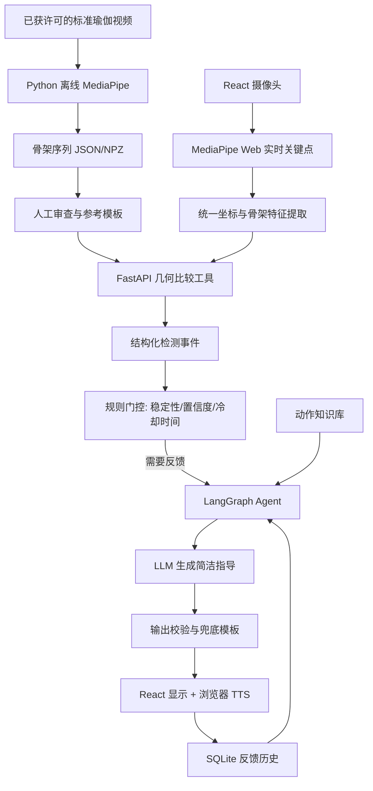
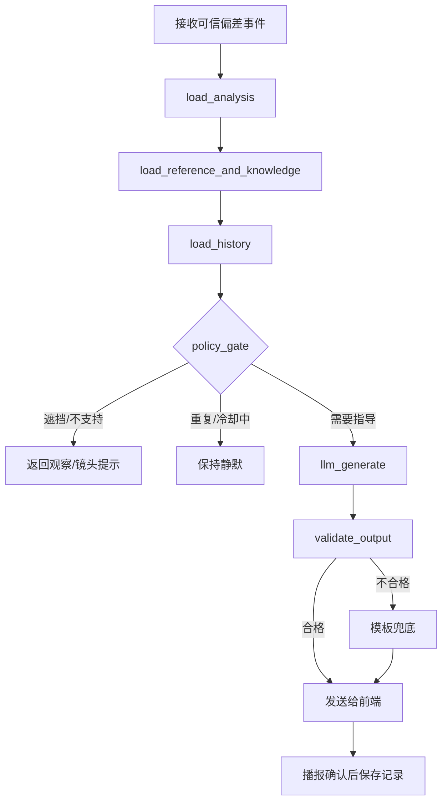

# YogaCoach Agent V1.0：基于骨架感知与 LLM Agent 的瑜伽姿态指导系统——详细实施方案

> **定位**：以 LLM / Agent 为核心的课程项目，而不是以训练分类网络为核心。  
> **V1 原则**：使用预训练 MediaPipe 进行关键点估计；使用确定性几何算法比较姿态；使用 LangGraph + LLM 进行有依据的反馈决策、语言生成和练习记录。**不训练 LLM，也不训练 TCN**。  
> **目标场景**：单人、电脑摄像头、固定机位、五种动作、用户先选择目标姿态、中文文字与语音指导。  
> **建议周期**：4～5 周；先完成端到端最小闭环，再增加功能。

---

## 1. 最终要做出的产品

用户打开网页 → 从动作库选择一个瑜伽姿势 → 查看标准示范视频/骨架 → 打开摄像头 → 系统绘制用户骨架 → 分析参考姿态与用户姿态之间的可观察差异 → LangGraph Agent 查询姿态分析、知识库和最近反馈 → 决定是否提醒以及如何表达 → 页面显示建议并语音播报 → 保存练习历史。

**V1 明确不做**：自动识别全部瑜伽动作、端到端从视频训练姿态纠错模型、医疗诊断、多用户实时检测、实时调用 VLM 逐帧分析、对所有体型使用唯一“标准角度”。

**功能验收**：支持 5 个姿势；能够显示标准视频与实时关键点；针对至少 3 类经人工审核的可观察偏差形成结构化结果；能够调用 Agent 给出不重复、简短、有依据的提示；结束时可查看训练记录；无视频摄像头权限或模型调用失败时能安全降级。

## 2. 核心架构与职责边界



### 哪些模块用模型？

| 模块 | 技术 | 是否训练 | 目的 |
|---|---|---|---|
| 骨架提取 | MediaPipe Pose Landmarker | 否，使用官方权重 | 输出 33 个关键点、可见性等 |
| 姿态比较 | Python/NumPy 几何规则 | 否 | 判断可可靠观察的具体偏差 |
| Agent 编排 | LangGraph | 否 | 读取分析/记忆/知识、决定反馈 |
| 自然语言反馈 | Qwen/DeepSeek 等可调用的聊天模型 | 否 | 把已验证偏差改写成清晰提示 |
| 语音 | Web Speech API | 否 | 播放文字反馈 |
| VLM | 后续可选 | 否 | 分析摄像头构图等，非骨架测量替代品 |

**重要界线**：LLM 不直接计算精确人体关节角度，也不能自行创造新的身体偏差事实；它只根据可信结构化结果提供语言表达。摄像头数据默认留在本地浏览器，仅上报关键点或特征；用户可随时关闭摄像头/停止记录。

## 3. 技术栈与运行环境

- **前端**：React、TypeScript、Vite、MediaPipe Tasks Vision、Canvas、浏览器 `speechSynthesis`。
- **后端**：Python 3.11、FastAPI、Pydantic、NumPy、OpenCV（仅离线处理）、SQLite、SQLAlchemy（可选）。
- **Agent**：LangGraph、LangChain 兼容的聊天模型接口或模型厂商 SDK、结构化 JSON 输出验证。
- **存储**：JSON / NPZ 参考模板、SQLite 会话记录、Markdown / JSON 动作指导知识库。
- **开发**：本地启动两个服务；初版不需要 GPU，也不需要向量数据库。

```bash
# backend（示例，安装具体版本按官方兼容要求锁定）
python3.11 -m venv .venv
source .venv/bin/activate
pip install fastapi 'uvicorn[standard]' pydantic numpy opencv-python mediapipe langgraph python-dotenv

# frontend
npm create vite@latest frontend -- --template react-ts
cd frontend
npm install
npm install @mediapipe/tasks-vision
npm run dev
```

LLM SDK 根据你实际选择的服务商接入。先使用一个可以输出结构化 JSON 的聊天模型 API；`API_KEY` 放在后端 `.env`，**不能**写在 React 前端。

## 4. 推荐项目结构

```text
YogaCoach-Agent/
├── README.md
├── .env.example
├── backend/
│   ├── app/main.py
│   ├── app/api/poses.py
│   ├── app/api/analyze.py
│   ├── app/api/feedback.py
│   ├── app/api/sessions.py
│   ├── app/services/geometry.py
│   ├── app/services/pose_evaluator.py
│   ├── app/services/reference_store.py
│   ├── app/agent/graph.py
│   ├── app/agent/tools.py
│   ├── app/agent/prompts.py
│   ├── app/agent/validators.py
│   ├── app/db/models.py
│   └── app/schemas.py
├── frontend/
│   ├── src/components/CameraView.tsx
│   ├── src/components/SkeletonCanvas.tsx
│   ├── src/components/ReferencePanel.tsx
│   ├── src/components/FeedbackPanel.tsx
│   ├── src/services/poseLandmarker.ts
│   ├── src/services/featureExtractor.ts
│   ├── src/services/api.ts
│   └── src/pages/Practice.tsx
├── scripts/
│   ├── extract_reference.py
│   ├── build_reference.py
│   └── inspect_reference.py
├── data/
│   ├── reference_videos/          # 本地素材，不默认上传仓库
│   ├── reference_landmarks/       # NPZ 或 JSON
│   └── reference_templates/       # 每种姿势一个 JSON
├── knowledge/                     # 经审核的动作指导信息
├── tests/
│   ├── test_geometry.py
│   ├── test_pose_evaluator.py
│   ├── test_feedback_guard.py
│   └── test_api.py
└── docs/
    ├── dataset.md
    ├── api.md
    └── experiments.md
```

## 5. 第一步：制作标准动作骨架库（离线）

### 5.1 选取动作

V1 选 5 个姿势（例如山式、猫式、眼镜蛇式、跪坐式、站立侧弯式）。每个姿势准备若干已获得许可的示范片段，尽量覆盖相同的摄像头视角、不同示范者和合理的姿态变化。首期优先正面拍摄可观察的动作；对需要侧面判断的动作单独标记视角。

### 5.2 视频 → 关键点

使用 Python 版 MediaPipe Pose Landmarker 的 `VIDEO` 模式，逐帧读取图像，按毫秒时间戳调用视频推理接口。提取每帧 33 个 landmarks，包括 `x,y,z` 与可用的 `visibility`/`presence`；同时保存 `timestamp_ms`、镜头视角、动作 ID、来源 ID。**具体模型路径与初始化参数以所安装版本的官方文档为准。**

保存格式建议：

```json
{
  "video_id": "ref_tadasana_01",
  "pose_id": "tadasana",
  "camera_view": "front",
  "fps": 15,
  "landmark_schema": "mediapipe_33_v1",
  "frames": [
    {"timestamp_ms": 0, "landmarks": [[0.51,0.23,0.0,0.99], "... 其余32个点"]}
  ]
}
```

这里是结构示意，真实文件必须存完整数值数组，不能含省略号。每个视频保留独立文件，避免测试时来源混淆。

### 5.3 骨架归一化

不能直接比较不同画面内的绝对像素坐标。推荐固定的处理顺序：

1. 统一图像坐标定义，区分镜像摄像头显示与真实左右标签。
2. 检查需要用到的关键点可见性；无效关键点保留掩码。
3. 对允许的短时间缺失进行插值，长期缺失不做纠错。
4. 使用左右髋中点为中心进行平移，用躯干长度（肩中点到髋中点）进行尺度归一化。
5. 根据摄像头视角提取几何特征；二维与世界三维坐标不要混算。
6. 可用 EMA 对关键点平滑，但测量平滑前后的延迟。

设肩中点为 \(s\)、髋中点为 \(h\)，\(p_i\) 是关节点的二维坐标：

\[
\widetilde p_i=\frac{p_i-h}{\max(\|s-h\|,\epsilon)}
\]

当躯干尺度极小、骨架缺失或镜头视角不合要求时，标记 `not_evaluable`。

### 5.4 提取参考特征

先关注可以稳定计算且与所选视角相适配的特征：肩部相对高度、躯干侧倾、左/右肘角度、左/右膝角度、肩肘腕相对位置、连续姿态稳定性。一个动作不必使用所有特征。各动作的规则由有经验的指导者审核。

从多个可信示范片段提取每个特征的统计分布，保存例如中位数、10%～90% 分位区间和可见性要求。**参考分布不是医学标准，也不代表每个人必须达到同一个角度。**

参考模板示例：

```json
{
  "pose_id": "tadasana",
  "display_name": "山式",
  "template_version": "v1",
  "camera_view": "front",
  "features": {
    "shoulder_height_diff": {
      "reference_low": 0.00,
      "reference_high": 0.09,
      "unit": "torso_normalized",
      "required_landmarks": [11, 12]
    }
  },
  "reviewed": false,
  "notes": "阈值仅为示意，必须由真实参考数据和人工审核确定"
}
```

不要用上面的演示阈值直接做实际人体指导；只有 `reviewed=true` 的模板才可触发纠错。

## 6. 第二步：实时摄像头与前端骨架

### 6.1 核心功能

1. 页面点击“允许摄像头”，通过 `navigator.mediaDevices.getUserMedia({video:true,audio:false})` 获取视频。
2. 加载 MediaPipe Web Pose Landmarker 模型（运行模式 `VIDEO`）。
3. 每次有可用画面时通过视频推理接口得到关键点。
4. `Canvas` 根据 33 点及骨骼连接表绘制火柴人。
5. 生成与离线模板一致的特征；只把有效分析样本发送给后端。
6. 提供“暂停分析”“静音”“结束练习”“删除记录”。

### 6.2 摄像头处理伪代码

```ts
// 说明：展示数据流，实际需按 @mediapipe/tasks-vision 当前 API 完整初始化
async function onVideoFrame(video: HTMLVideoElement) {
  if (!landmarker || video.readyState < 2) return;
  const result = landmarker.detectForVideo(video, performance.now());
  const landmarks = result.landmarks?.[0];
  if (!landmarks) {
    setTrackingStatus('lost');
    return;
  }
  drawSkeleton(landmarks);
  const features = extractPoseFeatures(landmarks);
  if (features.valid) enqueueForAnalysis(features);
}
```

**工程要求**：避免同时发起大量推理请求；限制分析请求频率至约 3～5 次/秒。初版优先 HTTP `POST /api/analyze`，成熟后再考虑 WebSocket。浏览器端绘制与后端决策应解耦，防止 LLM 延迟造成画面卡顿。

## 7. 第三步：确定性姿态比较工具（后端）

### 7.1 角度计算

```python
import numpy as np

def joint_angle(a, b, c):
    a, b, c = map(lambda x: np.asarray(x, dtype=float), (a, b, c))
    ba, bc = a - b, c - b
    denominator = np.linalg.norm(ba) * np.linalg.norm(bc)
    if denominator < 1e-8:
        return None
    cosine = np.clip(np.dot(ba, bc) / denominator, -1.0, 1.0)
    return float(np.degrees(np.arccos(cosine)))
```

### 7.2 参考区间比较

对一个可靠特征 \(v\) 以及参考区间 \([l,u]\)：

\[
d(v,[l,u])=\max(l-v,\,0,\,v-u)
\]

`d=0` 表示在参考范围内，`d>0` 表示存在可测差异，但**不自动等同于动作错误或健康风险**。最终是否提示还要看视角、可见性、时间稳定性和人工审核规则。

### 7.3 先规则、后 Agent

对每次分析按顺序检查：

1. 用户是否选定目标姿势？
2. 当前姿势是否处于稳定阶段？
3. 摄像头视角和关键点质量是否满足所用规则？
4. 是否有对应的已审核参考模板？
5. 差异是否连续维持约 1～2 秒？
6. 这条提示是否刚刚播报过（冷却建议 10～15 秒）？

只有满足条件才创建 `deviation_event`，交给 Agent。

标准化输出：

```json
{
  "session_id": "s_001",
  "pose_id": "tadasana",
  "tracking_quality": "good",
  "camera_view": "front",
  "evaluation_status": "deviation_detected",
  "events": [
    {
      "code": "shoulder_height_difference",
      "body_part": "shoulders",
      "observed_value": 0.13,
      "reference_interval": [0.00, 0.09],
      "unit": "torso_normalized",
      "severity": "mild",
      "confidence": 0.86,
      "duration_ms": 1800
    }
  ]
}
```

数值为格式示例，不是经过标定的实际检测。特别要注意：追踪模型给出的可见性与姿态偏差判断的可信度不是一回事；后者需要单独评估。

## 8. 第四步：LangGraph Agent（项目核心）

### 8.1 Agent 的独立职责

Agent 不接收任意一帧就开始随意聊天，而是对可靠事件进行 **检索 → 决策 → 生成 → 校验 → 记录**：

- 查询目标姿势的知识卡片；
- 读取当前偏差事件；
- 读取最近反馈及本次训练状态；
- 选择一个最值得反馈的观察点；
- 判断是提醒、保持静默还是提示调整摄像头；
- 调用 LLM 生成不超过 1～2 句的中文提示；
- 输出校验失败时使用固定模板；
- 在用户界面真正接收并确认播报后写入历史。

### 8.2 Agent 工具

| Tool | 输入 | 输出 | 谁提供事实 |
|---|---|---|---|
| `get_pose_reference` | `pose_id` | 参考指标、可用视角 | 已审核 JSON 模板 |
| `get_current_analysis` | `session_id` | 姿态测量、偏差事件 | 确定性几何模块 |
| `get_pose_knowledge` | `pose_id`、`event_code` | 已审核的反馈候选 | 本地知识库 |
| `get_feedback_history` | `session_id` | 近几条反馈及时间 | SQLite |
| `save_feedback_record` | 反馈 ID/内容/时间 | 存储结果 | 数据库 |

初版可将这些工具作为固定 LangGraph 节点依次调用，比允许 LLM 无限次调用工具更可控。进阶版再加入有限次数的动态工具选择。

### 8.3 状态模型

```python
from typing import TypedDict

class YogaState(TypedDict, total=False):
    session_id: str
    pose_id: str
    analysis: dict
    knowledge: dict
    recent_feedback: list[dict]
    should_respond: bool
    feedback_text: str
    feedback_code: str
    response_status: str
```

### 8.4 推荐工作流



### 8.5 LLM System Prompt（可直接作为初稿）

```text
你是 YogaCoach 的瑜伽练习指导助手。
你必须仅根据后端姿态分析工具、经过审核的动作知识库和最近反馈记录工作。
不得自行推断看不到的关节信息、身体状况、受伤风险或医学结论。
每次只关注一个经过确认的可观察偏差，不要求用户强行达到固定角度。
当跟踪失败、证据不足或视角不合要求时，建议调整拍摄条件，不做姿态纠错。
若用户表示疼痛、眩晕或明显不适，建议停止练习并寻求合适帮助。
避免重复以前刚刚播报的提示。采用简洁、礼貌、自然的中文，每条不超过 60 个汉字。
请严格返回 JSON：
{"should_speak":true/false,"feedback_type":"correction|camera|encouragement|none","target":"...","text":"..."}
```

### 8.6 Agent 输入与输出

输入：

```json
{
  "pose_id": "tadasana",
  "analysis": {
    "tracking_quality": "good",
    "events": [{"code":"shoulder_height_difference","duration_ms":1800,"severity":"mild"}]
  },
  "recent_feedback": [],
  "knowledge": {
    "shoulder_height_difference": "提醒放松肩膀并在舒适范围内观察左右位置"
  }
}
```

输出：

```json
{
  "should_speak": true,
  "feedback_type": "correction",
  "target": "shoulders",
  "text": "检测到双肩高度有些差异，可以先放松肩膀，观察两侧的位置。"
}
```

**必须后处理**：JSON Schema 验证、长度限制、事件引用白名单、重复提醒过滤、禁止扩展未经证实事实。对不合规结果使用审核过的模板，并记录失败原因。

## 9. 第五步：知识库与记忆

### 9.1 知识库不需要 RAG

第一版五个姿势，每个动作一份 Markdown/JSON 即可。例如 `knowledge/tadasana.json`：

```json
{
  "pose_id":"tadasana",
  "name_zh":"山式",
  "allowed_camera_views":["front"],
  "feedback_rules": {
    "shoulder_height_difference": {
      "observation":"肩部相对高度存在可观察差异",
      "safe_feedback":"可以放松肩膀，在舒适范围内观察两侧的位置。"
    }
  },
  "safety_note":"不强求固定的关节角度，出现不适请暂停练习。"
}
```

所有教学内容应由具备相关知识的人员审核；添加新的动作前要完善视角与质量检查。

### 9.2 SQLite 记忆结构

最小表设计：

- `sessions(id, started_at, ended_at, selected_pose, duration_sec, status)`
- `pose_events(id, session_id, timestamp_ms, pose_id, event_code, confidence, payload_json)`
- `feedback(id, session_id, event_id, feedback_code, text, created_at, delivered_at)`
- `session_summaries(session_id, summary_json, generated_at)`

优先使用会话级短期记忆：最近 5～10 条提示、已反馈的偏差类型、冷却时间和用户选择的动作。跨会话的长期记忆采用显式开关，允许清除。初版不需要 Mem0 或向量数据库。

## 10. 第六步：FastAPI 接口协议

| Method | Endpoint | 作用 |
|---|---|---|
| GET | `/api/health` | 健康检查 |
| GET | `/api/poses` | 列出五种动作及要求的拍摄视角 |
| GET | `/api/poses/{pose_id}/reference` | 获取参考模板及示范资源 |
| POST | `/api/sessions` | 创建练习会话 |
| POST | `/api/analyze` | 输入关键点/特征，返回结构化姿态分析 |
| POST | `/api/agent/feedback` | 对分析事件运行 Agent，返回指导或静默 |
| POST | `/api/sessions/{id}/feedback-ack` | 确认反馈已展示/播报 |
| POST | `/api/sessions/{id}/finish` | 结束会话、生成摘要 |
| GET | `/api/sessions/{id}/summary` | 获取总结 |
| DELETE | `/api/sessions/{id}` | 删除一次练习记录 |

### 10.1 `/api/analyze` 请求结构

```json
{
  "session_id": "s_001",
  "pose_id": "tadasana",
  "camera_view": "front",
  "timestamp_ms": 18600,
  "landmark_schema": "mediapipe_33_v1",
  "landmarks": [[0.51,0.23,0.0,0.98]]
}
```

`landmarks` 在真实请求中必须恰好 33 组数值；上述仅是缩写示例。服务端验证长度、类型、数值范围、时间戳和会话归属，再按统一特征规范计算差异。前端也可以发送已标准化的特征，但必须标明版本并防止重复归一化。

### 10.2 `/api/agent/feedback` 请求结构

```json
{
  "session_id": "s_001",
  "event_ids": ["evt_102"],
  "idempotency_key": "s_001_evt_102"
}
```

Agent 应只读取服务器已经计算和存储的事件，**不要信任前端直接提供的“检测结论”**。同一幂等键只处理一次，防止连续请求导致重复播报或多次计费。

### 10.3 FastAPI 最小骨架

```python
from fastapi import FastAPI
from pydantic import BaseModel, Field

app = FastAPI(title="YogaCoach Agent API")

class Landmark(BaseModel):
    x: float
    y: float
    z: float
    visibility: float = Field(ge=0, le=1)

class AnalyzeRequest(BaseModel):
    session_id: str
    pose_id: str
    camera_view: str
    timestamp_ms: int = Field(ge=0)
    landmarks: list[Landmark] = Field(min_length=33, max_length=33)

@app.get('/api/health')
def health():
    return {"status": "ok"}

@app.post('/api/analyze')
def analyze(req: AnalyzeRequest):
    # TODO: 校验 session / pose / view -> 几何特征 -> 历史窗口 -> 规则结果
    return {"evaluation_status": "not_implemented", "events": []}
```

该骨架是接口与校验示例，不是完整姿态检测实现；`Landmark` 对象应由前端统一映射，避免直接发送四维数组却用对象 Schema 接收。

## 11. 前端交互布局

```text
┌──────────────────────── YogaCoach Agent ────────────────────────┐
│ 姿势选择：[山式 ▼]      摄像头：[开启] [暂停] [结束]             │
├───────────────────────────┬─────────────────────────────────────┤
│     实时用户视频          │       标准动作视频                  │
│     Canvas 骨架覆盖       │       参考骨架/动作说明              │
├───────────────────────────┴─────────────────────────────────────┤
│ 跟踪状态：正常      当前姿势：山式       视角：正面              │
│ 观察到的差异：肩部高度差异（需经持续验证）                      │
│ AI 提示：可以先放松肩膀，观察两侧的位置。                        │
│ [语音开/关] [查看历史] [删除记录]                               │
└─────────────────────────────────────────────────────────────────┘
```

前端需显示“检测中/无法可靠检测/镜头视角不适合”等状态。`speechSynthesis.speak()` 仅在用户开启语音且反馈去重后调用；播报队列不应无限累积，新反馈可取消尚未播放的旧提示。

## 12. 具体分阶段开发与验收

### 阶段 A（第 1 周）：骨架可视化

- 启动 React + Vite 页面，申请摄像头权限。
- 加载 MediaPipe Web 模型并绘制 33 点火柴骨架。
- 上传一段有使用权的标准示范视频，离线导出关键点 JSON。
- 统一前后端关节编号、镜像和坐标版本。

**完成标志**：实时用户骨架和标准示范骨架都能可视化。

### 阶段 B（第 2 周）：参考模板与差异比较

- 选定前两种姿势先做通，再扩展到五种。
- 为每个姿势建立人工审核的模板 JSON。
- 实现角度/相对位置计算、遮挡检查、镜头视角规则和短时稳定性检测。
- 输出结构化事件；给同一偏差加入连续持续时间要求。

**完成标志**：在受控、舒适的演示条件下，能输出至少三种有依据的观察结果；看不到相关关节点时明确拒绝评价。

### 阶段 C（第 3 周）：LangGraph Agent

- 实现四个读取工具及反馈历史查询。
- 搭建 LangGraph：读取事件 → 读取知识 → 读取历史 → 门控 → LLM → 校验。
- 接入 Qwen/DeepSeek 的聊天 API。
- 增加重复反馈抑制、输出长度限制、错误模板兜底。

**完成标志**：同一姿态事件可以得到一次准确指导；重复或失效事件不会造成无限播报。

### 阶段 D（第 4 周）：语音、历史、完整网页

- 标准动作和用户视频并排展示。
- 支持浏览器中文 TTS 和静音。
- 记录会话、事件与已播报反馈。
- 实现结束练习后的摘要页面和删除按钮。

**完成标志**：完成从打开网页到练习报告的端到端演示。

### 阶段 E（第 5 周，可选）：实验与论文/PPT

- 比较固定模板反馈 vs LLM Agent 反馈。
- 比较无历史去重 vs 有历史去重。
- 比较不做质量门控 vs 做质量门控。
- 记录中位数/P95 处理延迟、LLM 调用次数、有效反馈率和误提醒情况。
- 展示失败案例与适用范围，不用未经检验的“矫正准确率”宣传系统。

## 13. 课程项目实验设计

| 实验 | A 方案 | B 方案 | 指标 |
|---|---|---|---|
| 反馈生成 | 固定模板 | Agent + 知识工具 | 事实一致性、可读性、延迟 |
| 历史记忆 | 无记忆 | 最近提示记忆 | 每分钟重复反馈次数 |
| 质量门控 | 直接报告偏差 | 可见性+稳定性+视角门控 | 错误提醒率、拒绝评价率 |
| 个性化 | 单次独立建议 | 基于会话历史 | 评审打分、重复率 |

**数据划分**：同一来源视频/同一参与者的片段不同时出现在训练或调参集与测试集。由于 V1 不训练纠错模型，可用独立评测视频集合评价规则和 Agent。建议每种姿势准备若干正常示范、明显遮挡、错误视角和经审核的轻微偏差案例，让评审不知道系统使用了何种反馈方案。

**不建议把数值阈值预先写死成论文“标准值”**；应记录阈值来源、审核方式及误报情况。

## 14. 测试清单

- [ ] 正常的单人画面可绘制骨架。
- [ ] 摄像头被拒绝时有明确错误提示。
- [ ] 双人画面不进行未经验证的姿态纠错。
- [ ] 遮挡相关关键点时不生成具体纠正建议。
- [ ] 前后端同一帧的角度计算结果一致。
- [ ] 未选择姿势时不调用纠错流程。
- [ ] 不支持的摄像头视角不进行角度评估。
- [ ] 同一事件只触发一次 Agent 调用。
- [ ] LLM API 超时或返回无效 JSON 时回退到模板。
- [ ] 输出不会把不确定的几何差异说成医学问题。
- [ ] 静音、结束会话、删除历史功能有效。
- [ ] API Key 不出现在浏览器网络请求和 Git 仓库中。
- [ ] 原始视频未经用户同意不会上传后端。

## 15. 最终交付物

1. 可运行的 React 前端与 FastAPI 后端。
2. 五种姿势的标准示范骨架/参考模板及来源说明。
3. 关节角度与姿态比较算法、相关单元测试。
4. LangGraph Agent 工作流、工具实现与提示词。
5. 动作知识库、SQLite 会话历史及反馈总结。
6. 课程实验（固定反馈 vs Agent、记忆消融、门控消融）。
7. README（环境、启动、截图、已知限制）与演示视频。

## 16. 今天就可以执行的开发顺序

**不要先做 LLM 微调，也不要先收集上千个视频。**

1. 建立 `YogaCoach-Agent` 仓库，启动 FastAPI `/api/health` 与 React 首页。
2. 在前端调用 MediaPipe，让摄像头画面上出现人体骨架。
3. 用一段标准山式视频离线提取同样的骨架。
4. 对比同一坐标系下的肩部、躯干等可观察特征，输出调试 JSON。
5. 手工添加一条已审核的姿态观察规则，接通 `/api/analyze`。
6. 最后接入 LangGraph 和 LLM，将分析 JSON 转换成一句合理的中文反馈。

当这六步跑通时，**核心 MVP 已经成立**。后续再扩展剩余四个姿势、历史记忆、语音、实验评估。

---

## 17. 技术文档入口

- MediaPipe Pose Landmarker（Web）：https://ai.google.dev/edge/mediapipe/solutions/vision/pose_landmarker/web_js
- MediaPipe Pose Landmarker（Python）：https://ai.google.dev/edge/mediapipe/solutions/vision/pose_landmarker/python
- LangGraph：https://docs.langchain.com/oss/python/langgraph/overview
- FastAPI：https://fastapi.tiangolo.com/
- React：https://react.dev/

> **项目总结**：V1 的研究重点不是“让 LLM 识别每个骨节”，而是用可解释视觉工具提供可信事实，让 LLM Agent 负责工具编排、上下文记忆、反馈决策和语言生成，构建可靠的多模态智能指导闭环。
