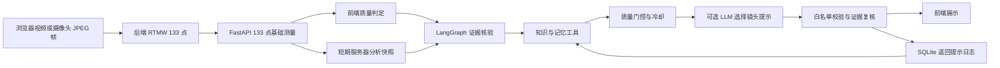

# 系统架构与当前能力

更新：2026-11-19。区分已实现机制与尚未验证的检测能力。



## Agent 工作流

`gate → tools → decide → compose → validate`，各节点通过 StateGraph 编排，提前拒绝的分支直接进入 validate。参考 [LangGraph StateGraph 官方说明](https://reference.langchain.com/python/langgraph/graph/state/StateGraph)。

- gate：拒绝 synthetic_mock；比对 `/api/analyze` 产生的完整服务器快照，最长 8 秒。客户端不能只靠修改 feedback_allowed 触发指导。
- tools：确定性调用分析快照、动作知识、会话记忆。会话必须存在、动作一致且尚未结束。工具调用不是 LLM 自主选择；历史读取不能等同于已验证个性化教学效果。
- decide：清晰画面仍返回“未校准”且不纠错；partial/poor 可进入镜头提示。同一会话镜头提示最多每 10 秒一次，并发请求共享冷却。
- compose：可选 chat-completions 兼容服务仅选择 full/short 提示编号；只发送经过白名单过滤的 feedback_length，不上传关键点、历史原文或会话标识。无配置、超时、HTTP/JSON/结构错误均使用固定模板。
- validate：再次确认原证据未过期、未被新清晰画面取代、会话未结束，然后记录返回的提示。日志表示服务器返回，不证明浏览器展示或语音播放成功。

模型生成的任意自由文本不会作为姿态建议返回。当前未实现经过校准的在线姿态纠错，也未用 LLM 自由生成教学建议。

## 配置和启动

根目录 `.env` 启动时加载，不覆盖已有环境变量：

```text
LLM_API_KEY=服务密钥
LLM_BASE_URL=https://你的兼容服务/v1
LLM_MODEL=模型名
```

不配置也可以运行，返回 mode=template。配置后，质量提示会尝试请求 `/chat/completions`，请求超时设置为 3 秒；mode=llm 表示选择成功。LLM 服务必须支持 JSON 对象返回。密钥仅在后端读取。

## 部署边界

当前分析快照、冷却都在单进程内存，最多各保留 2048 条。MVP 使用单个 Uvicorn worker；重启会清空临时状态。多 worker/多实例须迁移到共享存储并实现原子冷却，不能直接增加 workers。SQLite 仍保留会话和已返回提示日志。

主方案使用已有 `data/models/rtmw_x_384.onnx`，不需要前端 MediaPipe 模型。本机已完成参考图真实推理与 HTTP 链路验证，浏览器实际设备仍待验收。133 点规则的阶段审核与在线持续事件尚未接通。视频入口参见 [133 点链路](133点视频与摄像头链路.md)。

## 正式规则纠错更新

RTMW 图像推理后新增 `OnlineRules`：已审核配置比较 → 按会话持续事件 → reviewed_rules_133 输出 → LangGraph 事件校验与提示 → SQLite。当前启用范围是山式举臂保持的肘角规则，侧弯仍被审核门槛阻止。参考 [正式纠错说明](正式纠错实现与验收.md)，本节替代前文仅支持镜头提示的能力描述。
