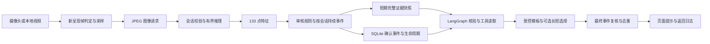

# 系统架构与当前能力

更新：2026-11-22。当前唯一真实感知主方案为后端 RTMW 133 点。

## 感知和时钟

`Source133` 管理来源，`capture` 服务负责新帧、冻结、有限重试和关闭。优先使用新呈现帧回调；回退使用呈现帧计数，不能确认新帧的浏览器不启动分析。摄像头以单调采集时间统计持续性，文件视频以媒体时间统计；服务器另用单调时钟判断图像请求是否过期。

暂停、拖动、缓冲、来源或阶段变化都会撤回旧反馈并重建流。新流可从较早媒体时间开始，序号仍递增。不同播放速度下采样覆盖可能不同，不对未观察到的片段补造证据。

## 在线规则

`rules_manifest.json` 是在线生效入口，配置按路径、修改时间和大小缓存，返回防御副本。旧 draft 比较器默认配置只供既有实验复现。山式仅启用已有 B 配置的举臂肘角规则；侧弯在线使用 `ardhakati_chakrasana_rules_B.json`，由用户授权启用课程演示，review_record明确未完成专业教学验证。单臂/双臂/阶段适用性由比较器的eligible_rule_ids保留到在线层，不将not_applicable规则当作缺失证据。独立旧草案保持门禁。

每会话独立持续事件，保留质量、间隔、阶段与来源校验。全局模型锁和规则状态锁仍保留在单 worker 中；并发上限限制排队，过期图像不参与纠错。缓存优化不绕过会话结束或删除检查。

## Agent 和记忆

LangGraph 流程为 gate → tools → decide → compose → validate。工具由节点确定性调用，不是 LLM 自主规划。完整服务器快照与最新事件状态都需匹配；缓存以会话索引查找最新帧，不减少内容核验。相同事件去重，并保留十秒纠错冷却。

LLM 可选，只接收白名单话术长度偏好并选择模板长短；不上传图像、关键点、历史原文或密钥到日志。服务器规则事件可用于延续关注重点，任意手写摘要不作为测量事实。模型失败、超时或输出异常时使用固定模板。

正式事件与反馈由后端写入，客户端原始导入默认禁用。测试导入开关仅在隔离测试使用。反馈日志表示服务器返回，不代表实际播放或用户已听到。心跳过期只标记中断，不伪造正常结束与改善。

## 运行和验证

`/api/health` 检查存活，`/api/ready` 提供模型、数据库、规则与可选 LLM 状态，不暴露绝对路径或密钥；开发日志记录实际数据库路径。同源构建托管在所有 API 路由之后，不需要 CORS。

当前限定 loopback、单人、单 worker；没有公网多用户鉴权。远端 CI 配置仅做快速测试与构建，真实模型需单独 LFS 获取和冒烟。真实效果结论必须有输出和人工标注，不把合成场景或延迟基准当作准确率。

详见 [133 点链路](133点视频与摄像头链路.md)、[正式纠错与验收](正式纠错实现与验收.md)、[本轮实施记录](改进实施记录.md)。
